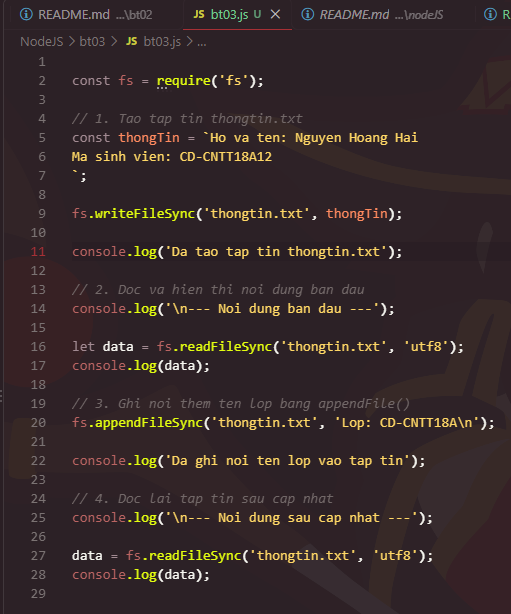
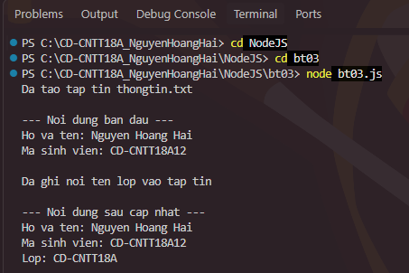

## 1. Cách chạy chương trình

Bước 1: Truy cập repository GitHub:

https://github.com/hoanghai-bot206/NodeJS.git

Bước 2: Chọn Code → Download ZIP để tải mã nguồn về máy tính.

Bước 3: Giải nén tập tin ZIP vừa tải về.

Bước 4: Mở Visual Studio Code, chọn File → Open Folder và mở thư mục chứa tập tin bai02.js.

Bước 5: Chọn Terminal → New Terminal để mở Terminal.

Bước 6: Kiểm tra Node.js đã được cài đặt:

node -v

Bước 7: Chạy chương trình bằng lệnh:

node bt03.js

## 2. Kết quả thực hiện

--- Noi dung ban dau ---

Ho va ten: Nguyen Hoang Hai

Ma sinh vien: CD-CNTT18A12

Da ghi noi ten lop vao tap tin

--- Noi dung sau cap nhat ---

Ho va ten: Nguyen Hoang Hai

Ma sinh vien: CD-CNTT18A12

Lop: CD-CNTT18A

## 3. Hình ảnh minh chứng

